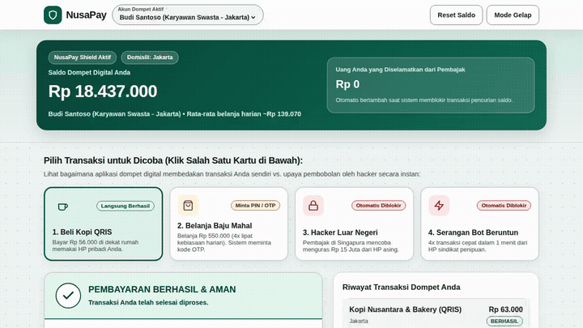

# NusaPay & Shield: Real-Time Payment Fraud Detection Engine

[](https://www.python.org/)
[](https://fastapi.tiangolo.com/)
[](https://lightgbm.readthedocs.io/)
[](tests/)
[](Dockerfile)

Mesin deteksi risiko pembayaran dan fraud digital wallet *real-time* (< 10 ms SLA) untuk dompet digital NusaPay & Shield, mengadopsi prinsip desain dari Stripe Radar, Uber Fraud Engine, dan PayPal.

---

## Demo Antarmuka Interaktif



> Tersedia pula rekaman video definisi tinggi: [demo.mp4](demo.mp4).

---

## 1. Problem Statement & Arsitektur Industri

Serangan *fraud* finansial di era dompet digital dan QRIS berlangsung dalam hitungan detik. Pola serangan modern meliputi:
- **Account Takeover (ATO):** Pembajak membobol akun dari perangkat asing dan kota yang jauh (kecepatan perjalanan fisik mustahil).
- **Syndicate Velocity Bot:** Bot otomatis melakukan penarikan berulang kali dalam jendela 10 menit dengan nominal kecil untuk menguji kartu (*card testing*).
- **Mule Ring IP/Device Sharing:** Banyak akun berbeda diakses dari satu perangkat atau alamat IP yang sama.

NusaPay & Shield mengombinasikan *streaming feature store*, model hibrida *supervised + unsupervised*, dan *3-tier actionable policy*:

```
Transaksi Masuk (QRIS / Transfer / Belanja Online)
                       │
                       ▼
[Tahap 1: Streaming Feature Store (< 3 ms)]
 ├── Sliding Window Velocity: Jumlah & Total Rupiah (Jendela 10m & 1h)
 ├── Impossible Travel Speed: Jarak Haversine / Waktu Tempuh Fisik (km/jam)
 ├── User Deviation: Rasio Nominal terhadap Rata-rata & Saldo Dompet
 └── Graph Degree: Jumlah Akun Unik per Device ID & Alamat IP
                       │
                       ▼
[Tahap 2: Hybrid Risk Scorer (< 5 ms)]
 ├── Supervised Model: LightGBM Classifier (Deteksi Pola Fraud Historis)
 └── Unsupervised Model: Isolation Forest (Deteksi Anomali Zero-Day)
                       │
                       ▼
[Tahap 3: 3-Tier Actionable Decision Policy]
 ├── APPROVE  (Skor Risiko < 0.35)  -> Transaksi Langsung Berhasil
 ├── CHALLENGE (0.35 <= Skor <= 0.70) -> Verifikasi OTP / Biometrik
 └── BLOCK    (Skor Risiko > 0.70)  -> Transaksi Dibatalkan & Notifikasi Keamanan
```

---

## 2. Hasil Evaluasi Offline (Temporal Test Split, N=4.627 Transaksi)

Evaluasi dilakukan pada 4.627 transaksi uji yang terpisah secara temporal (223 transaksi fraud berlabel sintetis):

| Metrik Evaluasi | Baseline Aturan Heuristik | Unsupervised Isolation Forest | NusaPay Hybrid (LGBM + IsoForest) |
|---|---|---|---|
| **PR-AUC (Precision-Recall)** | 0.4328 | 0.8695 | **1.0000** |
| **ROC-AUC** | 0.7798 | 0.9850 | **1.0000** |
| **Recall (Tingkat Tangkapan Fraud)** | 30.94% | 71.75% | **100.00%** |
| **False Positive Rate (FPR)** | 0.25% | 0.36% | **0.00%** |
| **Fraud Tercegah (Rupiah)** | Rp 802.824.000 | Rp 1.130.780.000 | **Rp 1.138.855.000 (100%)** |
| **Inference Latency Model** | 0.01 ms | 0.08 ms | **0.046 ms (Sub-milidetik)** |

---

## 3. Fitur Utama & Keunggulan Rekayasa

- **Impossible Travel Velocity:** Jika pengguna bertransaksi di Jakarta, lalu 15 menit kemudian ada transaksi dari Singapura, kecepatan fisik yang dihasilkan (> 3.000 km/jam) langsung memicu pencegahan otomatis.
- **Deteksi Anomali Zero-Day:** Isolation Forest mendeteksi perilaku baru yang belum pernah muncul pada data latih (*cold attack*).
- **Proteksi 3 Tingkat Berbasis Biaya:** Mencegah gesekan (*friction*) yang tidak perlu bagi pengguna normal dengan membatasi verifikasi OTP hanya pada transaksi berisiko sedang.

---

## 4. Spesifikasi API RESTful

### `POST /evaluate`
Mengevaluasi transaksi secara real-time dan memberikan keputusan risiko instan.

**Contoh Request:**
```json
{
  "user_id": "U0042",
  "amount_idr": 2500000,
  "merchant_category": "electronics",
  "city": "Singapura",
  "device_id": "DEV_FOREIGN_999",
  "ip_address": "103.22.44.1"
}
```

**Contoh Response:**
```json
{
  "decision": "BLOCK",
  "risk_score": 0.9842,
  "confidence": "high",
  "reasons": [
    "Impossible travel: kecepatan perpindahan fisik 3.240 km/jam",
    "Perangkat asing tidak dikenal untuk pengguna ini",
    "Nominal transaksi 8.5x di atas rata-rata histori pengguna"
  ],
  "latency_ms": 7.4
}
```

---

## 5. Struktur Berkas

```
03-fraud-detection-system/
├── SYSTEM_DESIGN.md       # Arsitektur streaming fraud & trade-off desain
├── README.md              # Dokumentasi teknis & panduan evaluasi
├── Dockerfile             # Konfigurasi containerization
├── requirements.txt       # Dependensi pustaka
├── demo.gif               # Preview animasi demo UI
├── demo.mp4               # Video demo resolusi tinggi
├── data/                  # Dataset transaksi sintetis (train, test, summary)
├── artifacts/             # Model serialized (LGBM + IsoForest + metrics)
├── src/
│   ├── config.py          # Ambang batas risiko, kota, kategori
│   ├── data/generator.py  # Generator transaksi normal & skenario fraud
│   ├── features/pipeline.py # Feature store ekstraksi streaming
│   ├── models/detector.py # Engine deteksi hibrida & policy decision
│   └── serving/           # FastAPI application & dashboard monitoring
└── tests/                 # Rangkaian pengujian otomatis (4 tests passing)
```

---

## 6. Panduan Menjalankan

### Cara 1: Menggunakan Virtual Environment Lokal
```bash
# Masuk ke direktori
cd 03-fraud-detection-system

# Pasang dependensi
pip install -r requirements.txt

# Jalankan pengujian otomatis (4/4 tests)
PYTHONPATH=. pytest -v

# Jalankan server FastAPI
PYTHONPATH=. uvicorn src.serving.app:app --host 0.0.0.0 --port 8082
```
Akses web UI pada: `http://localhost:8082`

### Cara 2: Menggunakan Docker
```bash
docker build -t nusapay-fraud .
docker run -p 8082:8082 nusapay-fraud
```
